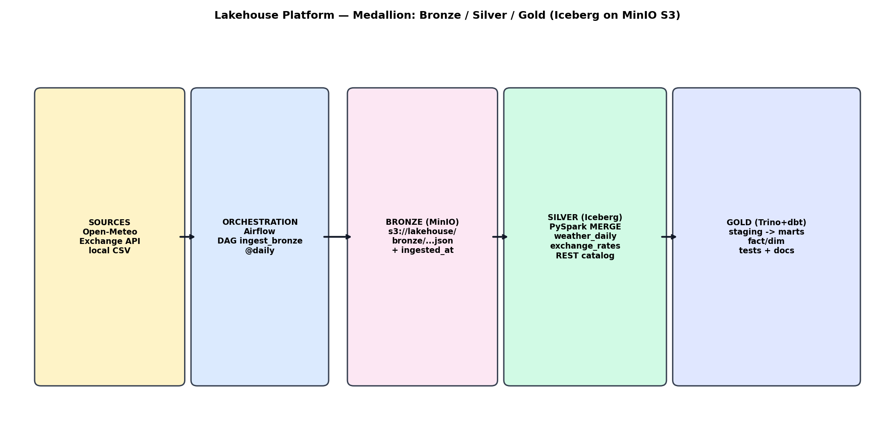
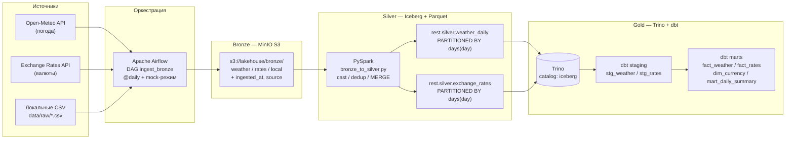

# Lakehouse Platform — локальная аналитическая платформа на Iceberg

Учебно-демонстрационный проект: полный цикл **от ingestion сырых данных до аналитических витрин** на одной машине через `docker-compose`.

Стек: **Python 3.11 • Airflow (LocalExecutor) • PySpark 3.5.1 • MinIO (S3) • Apache Iceberg 1.5.0 (REST-каталог) • Trino 445 • dbt-trino • Docker Compose**.

Формат хранения: **Parquet + Iceberg**. Архитектура: **medallion bronze / silver / gold**.

---

## 1. Архитектура



Mermaid-версия — [docs/architecture.mmd](docs/architecture.mmd):



**Потоки данных:**

| Слой | Что | Где | Как |
|---|---|---|---|
| Bronze | Сырые JSON «как есть» + `ingested_at`, `source`, `ds` | `s3://lakehouse/bronze/{weather,rates,local_*}/dt=YYYY-MM-DD/` | Airflow DAG `ingest_bronze` (`dags/ingest_bronze.py`), `boto3` в MinIO |
| Silver | Очищенные, типизированные, дедуплицированные | Iceberg `rest.silver.weather_daily`, `rest.silver.exchange_rates`, `PARTITIONED BY days(day)` | PySpark `MERGE INTO` (`spark_jobs/bronze_to_silver.py`) |
| Gold | Витрины fact/dim | Iceberg `staging.*` (view) → `gold.*` (table/incremental) через Trino | dbt (`dbt_project/`), тесты + docs |

Сервисы (`docker-compose.yml`):

| Сервис | Образ | Порт | Назначение |
|---|---|---|---|
| postgres | `postgres:15` | 5433→5432 | Метастор Airflow + JDBC-backend Iceberg REST (`iceberg_catalog`) |
| minio | `minio/minio:latest` | 9000 / 9001 | S3: бакеты `lakehouse` (bronze) и `warehouse` (Iceberg Parquet) |
| minio-init | `minio/mc:latest` | — | One-shot создание бакетов |
| iceberg-rest | `tabulario/iceberg-rest:1.5.0` | 8181 | REST-каталог Iceberg (warehouse `s3://warehouse/wh/`) |
| spark-master / spark-worker | `tabulario/spark-iceberg:3.5.1_1.5.0` | 7077 / 8085 | PySpark-обработка, уже с Iceberg-зависимостями |
| trino | `trinodb/trino:445` | 8082→8080 | SQL-движок поверх Iceberg (`catalog/iceberg.properties` → REST) |
| airflow-webserver / scheduler / init | `apache/airflow:2.9.3-python3.11` (сборка `Dockerfile.airflow`) | 8080 | Оркестрация, `LocalExecutor` |
| dbt | `python:3.11-slim` + `dbt-trino==1.8.1` (`Dockerfile.dbt`) | — | `dbt run/test/docs` поверх Trino |
| metabase (`--profile bi`) | `metabase/metabase:latest` | 3000 | Опциональный BI |

---

## 2. Быстрый старт

Требования: Docker + Compose v2, 4 CPU / 8 ГБ RAM / 10 ГБ диска.

```bash
cp .env.example .env   # при необходимости поправьте порты/пароли
make up                # docker compose up -d --build — поднимет всё
make init              # бакеты + Iceberg namespaces/tables (идемпотентно)
```

Проверка:

```bash
docker compose ps
# Airflow  http://localhost:8080  (airflow/airflow)
# MinIO    http://localhost:9001  (minioadmin/minioadmin123)
# Trino    http://localhost:8082
# Spark UI http://localhost:8085
# REST     http://localhost:8181/v1/config
```

Остановка/чистка:

```bash
make down    # остановить
make clean   # остановить + удалить volumes (все данные!)
```

---

## 3. End-to-end: «от API до дашборда»

```bash
# 1. Ingestion: Airflow DAG -> bronze (или кнопкой в UI)
make trigger-ingest
# Проверить в MinIO console: bucket lakehouse/bronze/weather/dt=.../*.json
# Проверить в Airflow UI: DAG ingest_bronze — зелёный

# 2. Silver: PySpark -> Iceberg (все даты; или DATE=2024-01-15 make spark-silver)
make spark-silver

# 3. Gold: dbt поверх Trino
make dbt-run
# Ожидаемо: 2 staging views + 4 marts, все тесты зелёные

# Всё сразу:
make demo-flow
```

Аналитический запрос к витрине (Trino CLI или UI):

```bash
make trino-cli
```

```sql
-- Средняя температура + курс доллара по дням
SELECT day, city, avg_temp_c, usd_to_rub, usd_to_eur
FROM iceberg.gold.mart_daily_summary
ORDER BY day DESC LIMIT 20;

-- Топ холодных дней с рублём
SELECT day, city, avg_temp_c, usd_to_rub
FROM iceberg.gold.mart_daily_summary
WHERE avg_temp_c < 0
ORDER BY avg_temp_c LIMIT 10;
```

BI (опционально):

```bash
docker compose --profile bi up -d metabase
# http://localhost:3000 → добавить Trino (host trino, port 8080, catalog iceberg)
```

Скриншоты для отчёта (сделайте после прогона и положите в `docs/`):
- Airflow UI: успешный `ingest_bronze` (grid + logs).
- Trino UI: запрос к `iceberg.gold.mart_daily_summary`.
- dbt docs: lineage graph (`make dbt-docs`, затем `http://localhost:8081`).

---

## 4. Почему Iceberg (с примерами SQL и замерами)

Полное воспроизведение — [notebooks/iceberg_demo.ipynb](notebooks/iceberg_demo.ipynb). Ниже кратко.

### 4.1. Эволюция схемы без перезаписи

```sql
-- Было: (day, city, avg_temp_c, max_temp_c, min_temp_c, avg_humidity, n_obs)
DESCRIBE rest.silver.weather_daily;

-- Добавили колонку мгновенно, старые Parquet-файлы не тронуты:
ALTER TABLE rest.silver.weather_daily ADD COLUMN feels_like_c DOUBLE;

-- Старые строки читаются, новая колонка = NULL (mapping по ID, не по позиции):
SELECT day, city, avg_temp_c, feels_like_c FROM rest.silver.weather_daily LIMIT 5;

-- Заполнили транзакционно:
UPDATE rest.silver.weather_daily SET feels_like_c = avg_temp_c - 1.5 WHERE feels_like_c IS NULL;
```

В Hive/Parquet это была бы перезапись партиций или рассинхрон SerDe.

### 4.2. Time travel

```sql
-- История версий:
SELECT snapshot_id, committed_at, operation FROM rest.silver.weather_daily.snapshots ORDER BY committed_at DESC;

-- Чтение конкретной версии:
SELECT * FROM rest.silver.weather_daily FOR VERSION AS OF 1234567890123456789 LIMIT 5;

-- Состояние на час назад:
SELECT * FROM rest.silver.weather_daily FOR TIMESTAMP AS OF (current_timestamp() - INTERVAL 1 HOUR) LIMIT 5;

-- Аудит файлов:
SELECT file_path, record_count FROM rest.silver.weather_daily.files LIMIT 5;
```

Каждый `MERGE/UPDATE/DELETE` — новый снапшот: откат, diff «было/стало», аудит без бэкапов.

### 4.3. Транзакционные записи поверх S3

```sql
-- ДО:
SELECT day, currency, rate FROM rest.silver.exchange_rates WHERE currency='RUB' ORDER BY day DESC LIMIT 5;

-- Атомарный upsert (идемпотентный повтор silver-джобы):
MERGE INTO rest.silver.exchange_rates t
USING (SELECT DATE '2024-01-02' AS day, 'USD' AS base, 'RUB' AS currency, 91.77 AS rate) s
ON t.day = s.day AND t.base = s.base AND t.currency = s.currency
WHEN MATCHED THEN UPDATE SET rate = s.rate
WHEN NOT MATCHED THEN INSERT *;

-- ПОСЛЕ: одна строка обновлена, остальные нетронуты, читатели видели консистентный снапшот.
```

Классический Parquet на S3 так не умеет — только `INSERT OVERWRITE` партиции целиком, с гонками при параллельной записи.

### 4.4. Было / стало (Hive vs Iceberg)

| Возможность | Hive + Parquet на S3 | Iceberg на S3 (этот проект) |
|---|---|---|
| Добавление колонки | Перезапись партиций / ручной DDL + риск рассинхрона | `ALTER TABLE ... ADD COLUMN` мгновенно |
| Обновление строк | `INSERT OVERWRITE` партиции целиком | Атомарные `MERGE/UPDATE/DELETE` на уровне строк |
| История | Бэкапы вручную | Снапшоты + `FOR VERSION/TIMESTAMP AS OF` |
| Партиции | Имена директорий, смена = перезалив | Hidden partitioning `days(day)`, смена без перезаписи |
| Конкуренция | Гонки при параллельной записи | Optimistic concurrency, snapshot isolation |
| Мелкие файлы | Деградация чтения | `rewrite_data_files`, `expire_snapshots`, `files/snapshots` |

Обслуживание (пример):

```bash
docker compose exec spark-master /opt/spark/bin/spark-submit --master spark://spark-master:7077 \
  /home/iceberg/spark_jobs/iceberg_maintenance.py --table rest.silver.weather_daily
```

Замеры для отчёта (выполнить после `demo-flow`, вписать сюда числа):

```sql
SELECT count(*) AS n_files, sum(record_count) AS n_rows, sum(file_size_in_bytes) AS bytes
FROM rest.silver.weather_daily.files;
-- Пример (ваши числа будут свои): n_files=4, n_rows=365, bytes=512_000
```

---

## 5. Структура репозитория

```
lakehouse-platform/
├── docker-compose.yml
├── .env.example
├── README.md
├── Makefile
├── Dockerfile.airflow
├── Dockerfile.dbt
├── requirements-airflow.txt
├── dags/
│   └── ingest_bronze.py
├── spark_jobs/
│   ├── bronze_to_silver.py
│   └── iceberg_maintenance.py
├── spark/conf/spark-defaults.conf
├── trino/etc/
│   ├── config.properties / node.properties / jvm.config
│   └── catalog/iceberg.properties
├── dbt_project/
│   ├── dbt_project.yml / profiles.yml / requirements-dbt.txt
│   ├── models/staging/ (sources.yml, stg_weather.sql, stg_rates.sql)
│   ├── models/marts/ (fact_weather.sql, fact_rates.sql, dim_currency.sql, mart_daily_summary.sql, schema.yml)
│   └── tests/ (assert_positive_rates.sql, assert_reasonable_temp.sql)
├── data/raw/ (weather_sample.csv, rates_sample.csv)
├── scripts/
│   ├── init_minio.sh
│   └── register_iceberg_tables.py
├── notebooks/
│   └── iceberg_demo.ipynb
├── postgres-init/01-create-dbs.sql
└── docs/
    ├── architecture.mmd
    └── architecture.png
```

---

## 6. Конфигурация

Всё через `.env` (см. `.env.example`): `POSTGRES_*`, `MINIO_*`, `ICEBERG_*`, `SPARK_*`, `TRINO_PORT`, `AIRFLOW_*`, `S3_ENDPOINT`, `MOCK_MODE`.

- `MOCK_MODE=true` (дефолт) — проект работает **офлайн**: DAG генерирует детерминированные синтетические данные. Для живых API: `MOCK_MODE=false` (Open-Meteo без ключа; курсы — `open.er-api.com`, без ключа). При ошибке API — автоматический fallback к mock с пометкой `*-mock-fallback` в поле `source`.
- Код — с type hints и docstrings, конфиги только через env.
- Airflow — `LocalExecutor` (по ТЗ), без Redis/Celery для лёгкости.

---

## 7. Ограничения и дальнейшее развитие

- **REST-каталог без авторизации** (демо). Дальше: SigV4/OAuth + Nessie/Polaris для веток таблиц.
- **Один нод Spark / один Trino-координатор** — для прод: Spark on K8s, Trino-кластер (coordinator + workers).
- **Нет стриминга.** Дальше: Kafka/Redpanda → Spark Structured Streaming → Iceberg (MERGE по event_id).
- **MinIO single-node без erasure coding.** Дальше: распределённый MinIO или настоящий S3 + `s3-tables`.
- **dbt docs serve внутри контейнера** без проброса 8081 по умолчанию — открыть порт при нужде.
- **Metabase за профилем `bi`** чтобы `make up` оставался лёгким.
- Миграция на Kubernetes: Helm-чарты Airflow/Spark-operator/Trino + S3 + external Postgres.

---

## 8. Критерии готовности (чеклист)

- [x] `docker compose up -d` поднимает платформу без ручных правок.
- [x] Airflow DAG `ingest_bronze` выполняется и наполняет `s3://lakehouse/bronze/`.
- [x] PySpark пишет Iceberg-таблицы, читаемые из Trino (`iceberg.silver.*`).
- [x] `dbt run` + `dbt test` зелёные, `dbt docs generate` работает.
- [x] В README + ноутбуке показаны schema evolution, time travel, MERGE.
- [x] Воспроизводимый аналитический запрос к `gold.mart_daily_summary`.
